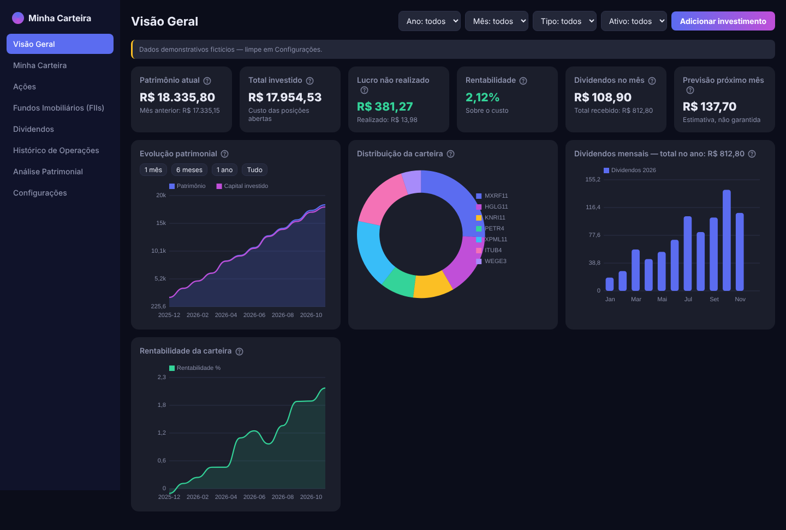
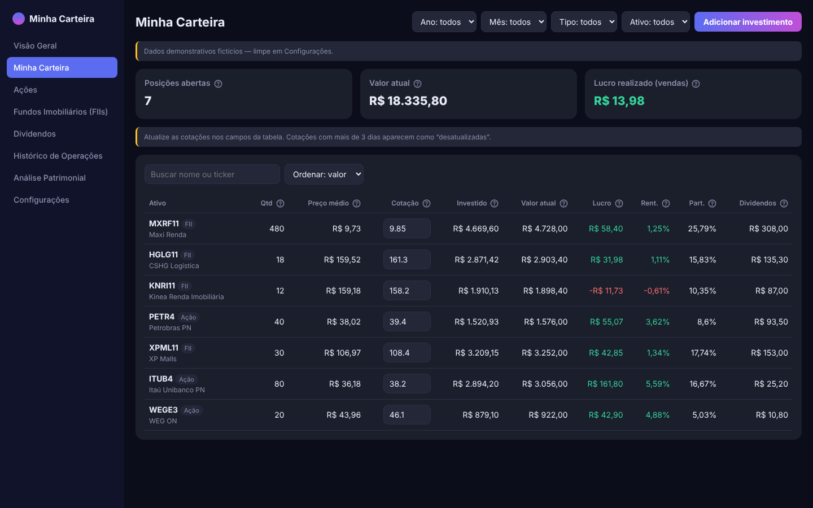
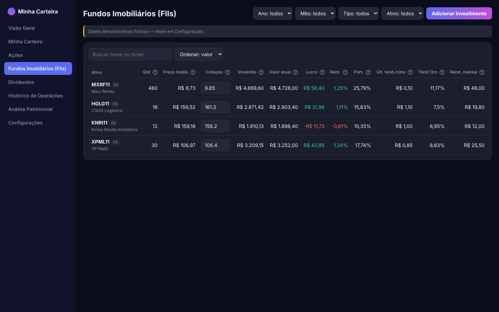
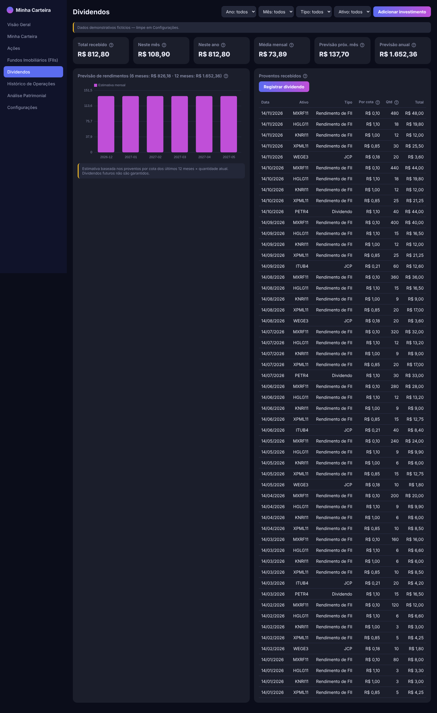
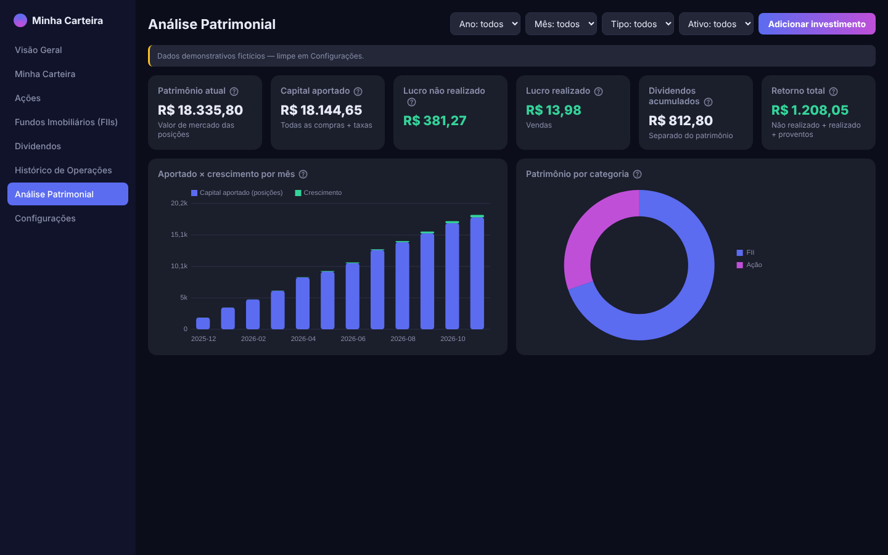
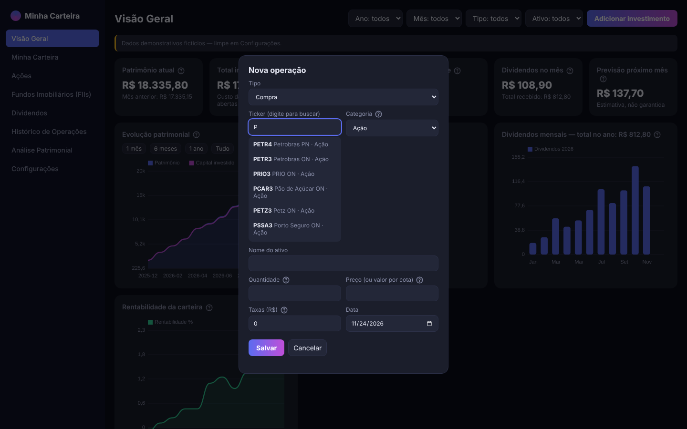
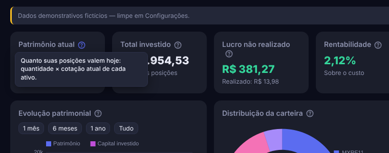
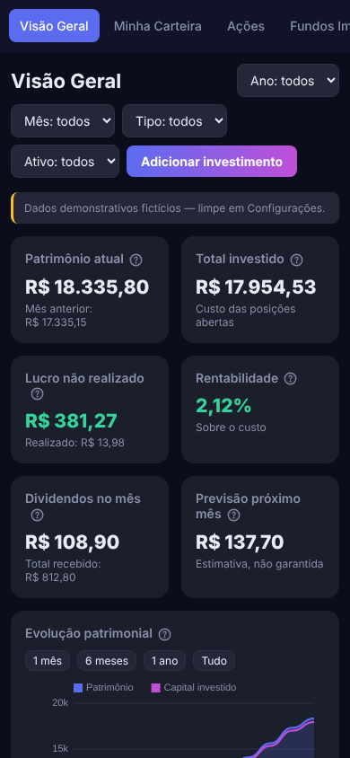
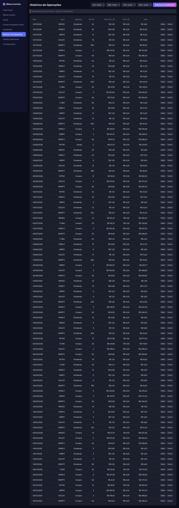

<div align="center">

# 📈 Carteira — Dashboard de Investimentos

Acompanhe seu patrimônio, rentabilidade e dividendos de **ações e FIIs** em um painel escuro, rápido e sem cadastro.


</div>

## 🖼️ Telas

> Capturas com **dados demonstrativos fictícios**.



| Minha Carteira | FIIs |
| --- | --- |
|  |  |

| Dividendos e previsão | Análise patrimonial |
| --- | --- |
|  |  |

| Busca de ativos ao digitar | Ajuda (?) em cada indicador | Celular |
| --- | --- | --- |
|  |  |  |



## ✨ Funcionalidades

- **Visão Geral** com patrimônio, total investido, lucro, rentabilidade, dividendos do mês e previsão do próximo mês.
- **Gráficos interativos:** evolução patrimonial, distribuição da carteira, dividendos mensais e rentabilidade.
- **Minha Carteira, Ações e FIIs** com preço médio, cotação, lucro, participação, Dividend Yield e rendimento mensal.
- **Central de Dividendos** com cadastro de proventos e **previsão de rendimentos** (6 e 12 meses).
- **Histórico de Operações** com compras, vendas e dividendos, com edição e exclusão.
- **Análise Patrimonial:** dinheiro aportado × crescimento, lucro realizado × não realizado.
- **Autocomplete de ativos:** digite `P` e veja PETR4, PRIO3… (lista local de ações, FIIs, ETFs e BDRs da B3).
- **Ícones de ajuda (?)** explicando cada indicador, gráfico e coluna.
- **Filtros globais** por ano, mês, tipo e ativo.
- Tema escuro/claro, layout responsivo e valores no padrão brasileiro (R$).
- **Backup:** exporte e importe sua carteira em JSON.

## 🧮 Como os cálculos funcionam

| Indicador | Fórmula |
| --- | --- |
| Preço médio | custo total (compras + taxas) ÷ quantidade, ponderado por todas as compras |
| Valor atual | quantidade × cotação atual |
| Lucro não realizado | valor atual − custo de aquisição |
| Rentabilidade | lucro ÷ custo de aquisição × 100 |
| Lucro realizado | preço de venda − preço médio − taxas (por venda) |
| Dividend Yield (12m) | proventos por cota nos últimos 12 meses ÷ cotação atual |
| Previsão mensal | proventos por cota dos últimos 12 meses ÷ meses de histórico × quantidade atual |

Patrimônio, capital aportado e proventos são mantidos separados para evitar dupla contagem.
A previsão de dividendos é uma **estimativa baseada em pagamentos anteriores e não é garantida**.

## 🗂️ Estrutura

```
index.html          página única
docs/               capturas de tela usadas neste README
css/styles.css      tema escuro/claro e layout responsivo
js/store.js         estado, localStorage e formatação em R$
js/calc.js          preço médio, posições, lucro realizado, dividendos e previsão
js/components.js    gráficos (Chart.js), cards, filtros e tabelas
js/pages.js         as 8 páginas do sistema
js/ativos.js        lista local de ativos da B3 + autocomplete
js/ajuda.js         ícones (?) e tooltips
js/forms.js         formulário de operações, dados demo, exportar/importar JSON
js/app.js           renderização principal
```

JavaScript puro (scripts clássicos, sem framework e sem etapa de build). Os gráficos usam Chart.js via CDN.

## 🚀 Como usar

**Localmente:** baixe o projeto e abra o `index.html` no navegador.

**Na Vercel:** envie o repositório ao GitHub, importe em [vercel.com/new](https://vercel.com/new) e clique em Deploy. É um site estático: sem build e sem variáveis de ambiente.

## 🔒 Privacidade e dados

Não há servidor, banco de dados nem login. Tudo fica salvo no **localStorage do seu navegador** e nada é enviado para fora.

- Limpar os dados do navegador apaga a carteira, e outro aparelho começa vazio.
- Use **Configurações → Exportar JSON** para fazer backup e **Importar JSON** para restaurar ou migrar de aparelho.
- As cotações são atualizadas manualmente na tabela da carteira; cotações com mais de 3 dias aparecem como “desatualizadas”.

## 🗺️ Próximos passos

- Atualização automática de cotações via API.
- Versão com login e banco de dados (PostgreSQL/Neon) para sincronizar entre dispositivos.
- Mais ativos na lista de autocomplete (`js/ativos.js`, formato `TICKER|Nome|A/F/E/B`).

## ⚠️ Aviso

Este projeto é uma ferramenta de acompanhamento pessoal. Não constitui recomendação de investimento, e os valores exibidos dependem dos dados informados por você.
